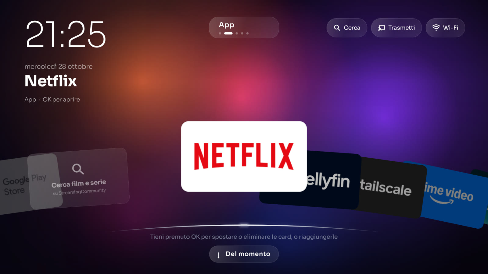
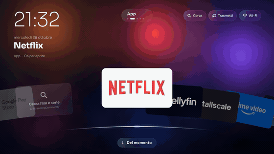
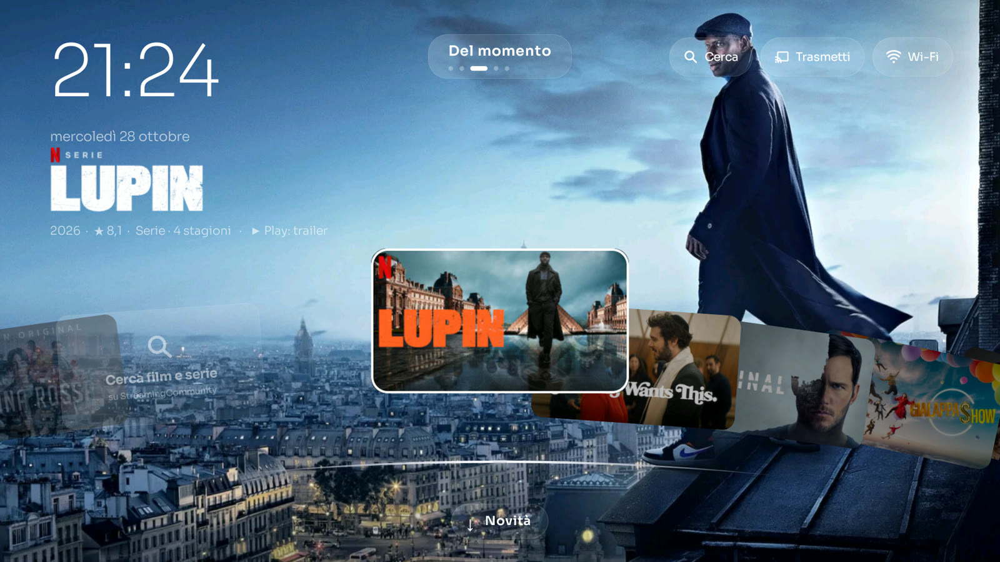
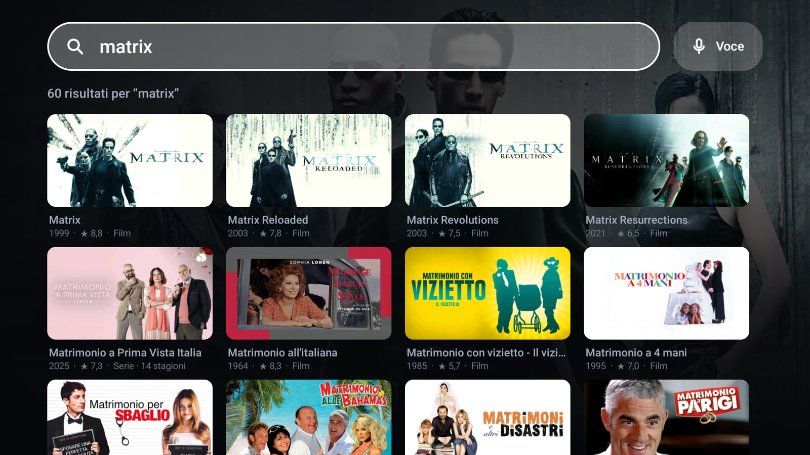
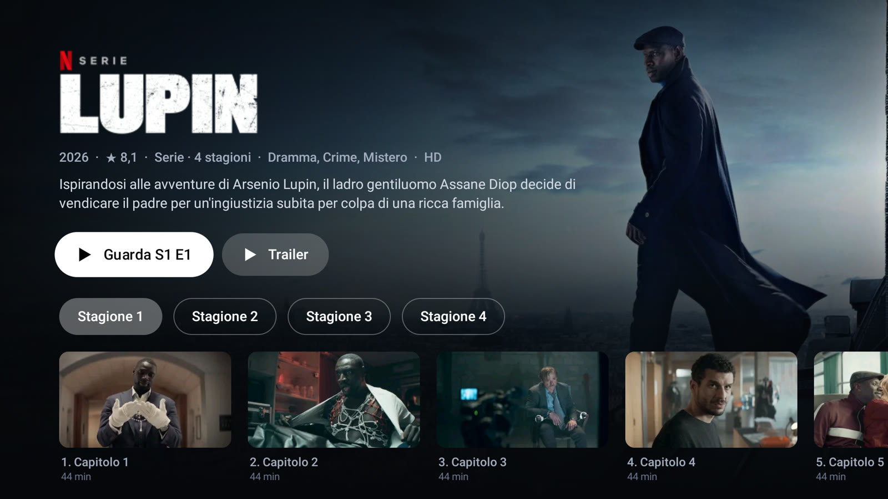
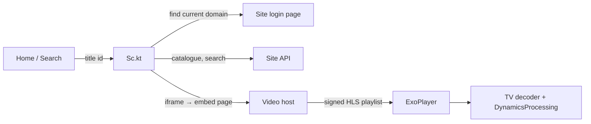

<div align="center">

# TVHome

**A fast, good-looking Home screen for cheap Android TVs, with built-in search and playback. No streaming subscriptions needed.**




</div>

## What it is

The launcher that ships with a budget Android TV is slow, full of ads and sponsored rows, and wants a subscription for everything. TVHome replaces it with one screen: a fan of cards (continue watching, your apps, what's trending, new releases, top 10) over a slowly moving dusk background.

Pick a title and it plays. Search, catalogue and streams are fetched on the TV itself from StreamingCommunity, so **you need no streaming subscriptions and no server or computer on the side**.

It was built on a TCL TV with 1 GB of RAM and a weak GPU, so most of the code is about doing less: one small bitmap stretched over the screen instead of seven blended layers, cards freed while a film plays, a decoder workaround for the TV's flaky H.264 chip.

## Look and feel

<div align="center">

</div>

- **One fan of cards.** ← → browse, ↑ ↓ switch section (Continue, Apps, Trending, New, Top 10). The list loops. Animations stay smooth on budget hardware (the GIF above was recorded on a real TV, not an emulator).
- **Film preview.** Rest on a title for a moment and its backdrop fades in over the background.

<div align="center">

</div>

- **Hold OK** on a card to move it, hide it from the Home, or bring it back.
- **Cinema transition.** Pressing play closes cinemascope bars, goes to black with the title, then starts the film.

<div align="center">
 
</div>

## What it does

- **Search** across the whole catalogue, using the TV's own keyboard.
- **Voice search**: say "cerca *Matrix* su TV home" to the Google Assistant button. TVHome reads what the Assistant heard and runs the search itself.
- **Player** (ExoPlayer, HLS) that resumes where you stopped, remembers each episode, offers the next one, and survives weak Wi-Fi by retrying with a fresh link.
- **Audio compressor** for night viewing: dialogue stays audible, explosions don't wake the house. It uses Android's own `DynamicsProcessing`.
- **Trailers** open in the YouTube TV app.
- Shows the Wi-Fi name, and explains Chromecast in three steps for people who don't know the TV has it.

## How it works



Everything runs on the TV. The site's domain changes often, so `Sc.kt` looks up the current one on start and caches it.

## Install

You need a TV with Android 9 or newer and [ADB](https://developer.android.com/tools/adb) on your computer. Turn on Developer options and network debugging on the TV first.

1. Download `TVHome.apk` from the [Releases](../../releases) page, or build it yourself (see below).
2. Connect and install:

```bash
adb connect <TV_IP>:5555
adb install -r TVHome.apk
adb shell pm grant dev.stek.tvhome android.permission.ACCESS_FINE_LOCATION   # needed to read the Wi-Fi name
adb shell pm grant dev.stek.tvhome android.permission.WRITE_SECURE_SETTINGS  # lets the app keep voice search switched on
```

3. Make it the Home. Press the Home button and pick TVHome as the default. If the TV keeps asking for its own launcher, disable it (the package name varies by brand; on the TCL it was `com.google.android.tvlauncher`):

```bash
adb shell pm disable-user --user 0 com.google.android.tvlauncher
# undo: adb shell pm enable com.google.android.tvlauncher
```

> **Fill in your own values.** Anything that depends on your network is left for you to complete. Replace `<TV_IP>` above with your TV's address. The same goes for `sony-restore.sh`, which reads it from the `TV_IP` variable:
> `TV_IP=<your TV's IP> ./sony-restore.sh`

### Build from source

```bash
git clone https://github.com/stek765/TV-Home.git && cd TV-Home
echo "sdk.dir=/path/to/android/sdk" > local.properties   # your own SDK path
./gradlew :app:assembleDebug
# → app/build/outputs/apk/debug/app-debug.apk
```

## Language

The interface text is in **Italian**. If you want it in English, have an AI translate the strings: paste the `.kt` files in `app/src/main/java/dev/stek/tvhome/` and `app/src/main/res/values/strings.xml` into any assistant and ask it to translate every user-visible Italian string, leaving the code unchanged. The voice trigger ("cerca … su TV home") lives in `Voice.kt`.

## Limits

- Tested on two TVs: a TCL (Android 11, 1 GB RAM) and a Sony BRAVIA (Android 9, 2 GB). Anything else is untested.
- The TCL's hardware H.264 decoder refuses some normal files; TVHome falls back to the software decoder for those titles (720p max). After many abrupt interruptions the chip can stay broken until the TV is rebooted.
- Don't install an update while a film is playing.
- Voice search depends on how the Google Assistant prints a command on screen; it can break with an Assistant update. Only the "cerca/trova … su TV home" phrasing is supported.
- The Wi-Fi name needs the system location switched on, not just the app permission.
- The streaming source can move, change protection or go offline without notice.
- It replaces the launcher; Live TV apps keep working but are not integrated.

## Legal

TVHome hosts no content. It is a client for a third-party website, and what you watch with it is your responsibility under the laws of your country. It is not affiliated with TCL, Sony, Google or any streaming service.

## Layout

```
app/src/main/java/dev/stek/tvhome/
  MainActivity.kt    Home: the fan, sections, remote handling
  Ui.kt              cards, pills, dusk background, horizon, image loader
  Sc.kt              domain discovery, catalogue, search, stream extraction
  PlayerActivity.kt  ExoPlayer, decoder workarounds, retries, compressor
  SearchActivity.kt  search screen
  DetailActivity.kt  title page, seasons and episodes
  Voice.kt           voice-search accessibility service
  Store.kt           "continue watching" storage
sony-restore.sh      re-enables the Sony system apps that were disabled
```

## License

[MIT](LICENSE). The Sora font is bundled under the SIL Open Font License.
